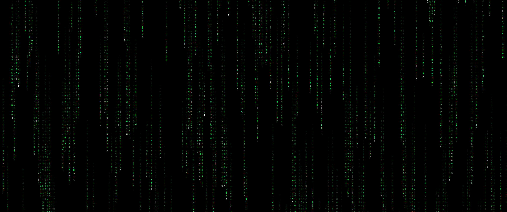

# Matrix Rain Screensaver

A lightweight Windows screensaver that shows green falling "digital rain" (katakana, digits and symbols) on **every monitor at once**. It works with any monitor layout, including ultrawides, portrait screens and negative desktop coordinates.



- One full-screen window per monitor, sized correctly at any DPI scaling
- Low CPU use: only changed cells are redrawn, using GDI blits from a pre-rendered glyph atlas (about 3 ms per frame at 3440x1440)
- Standard screensaver modes: `/s` full screen, `/p` the small preview in Screen Saver Settings, `/c` the settings dialog
- Settings: falling speed, amount of rain, font size, colour (green, cyan, blue, purple, red, amber, white)

## Keyboard controls while it's running

| Key | Effect |
| --- | --- |
| `0`-`9` (top row or numpad) | Set falling speed: `0` slowest, `9` fastest (each step is about 1.33x faster) |
| `d` | Less rain: density steps down from 1.0 to 0.1 (the share of columns that rain) |
| `D` (Shift+d) | More rain: density steps up to 1.0 |
| `f` | Smaller characters: font size steps down to 0.1 |
| `F` (Shift+f) | Bigger characters: font size steps up to 1.0 |
| Any other key, a click, or moving the mouse | Exit |

An indicator box shows the new speed, density or font size for a moment. Changes made with the keys are remembered next time.

## Ctrl+M hotkey (optional)

`hotkey-install.ps1` makes **Ctrl+M** start the rain at any time. It runs a tiny listener (`MatrixRain.exe /hotkey`) now and at every sign-in, with no admin rights needed. `hotkey-uninstall.ps1` removes it. While it's installed, apps no longer receive Ctrl+M.

The listener also checks once a minute that the screen saver is still switched on. Some apps (video calls, games) switch the screen saver off and never switch it back on. When that happens, the listener puts back the settings saved in Screen Saver Settings and notes the app that was in front in `screensaver-restore.log`. If you choose (None), it leaves the screen saver off.

## Build

No downloads are needed. It builds with the C# compiler that ships with Windows (.NET Framework 4.x):

```powershell
powershell -ExecutionPolicy Bypass -File build.ps1
```

This produces `MatrixRain.scr` (the screensaver) and `MatrixRain.exe` (the same program, used by the hotkey).

## Install

Download `MatrixRain.scr` from the [latest release](https://github.com/aybab2/matrix-rain-screensaver/releases/latest) (or build it), then right-click it and choose **Install**, or run:

```powershell
powershell -ExecutionPolicy Bypass -File install.ps1 -TimeoutMinutes 10
```

This sets the screensaver for the current user only, with no admin rights needed. Keep the folder where it is, because Windows runs the `.scr` from there. `uninstall.ps1` turns the screensaver off.

## Change the timeout or switch it off

Press the Windows key, type **screen saver**, and open **Change screen saver**. Change the **Wait** box, or choose **(None)** to switch it off.

